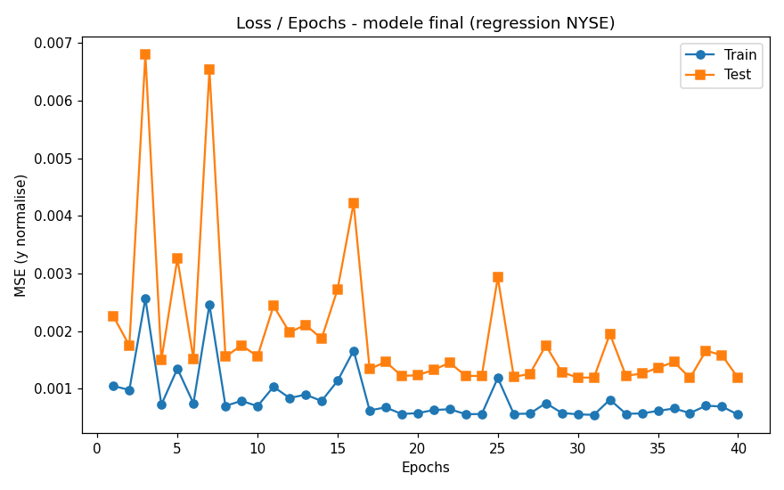
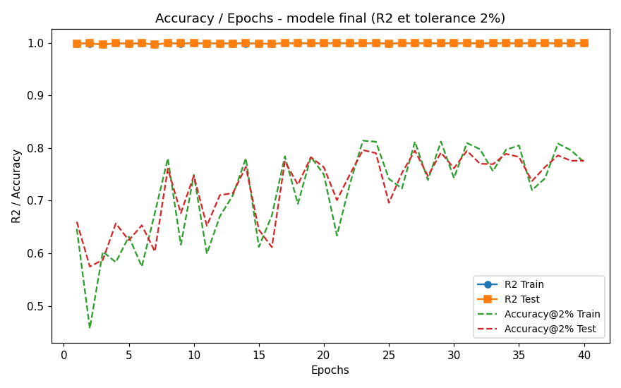
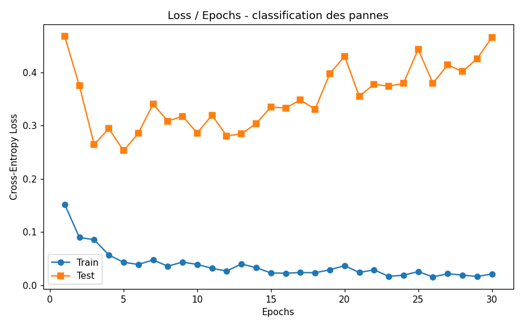
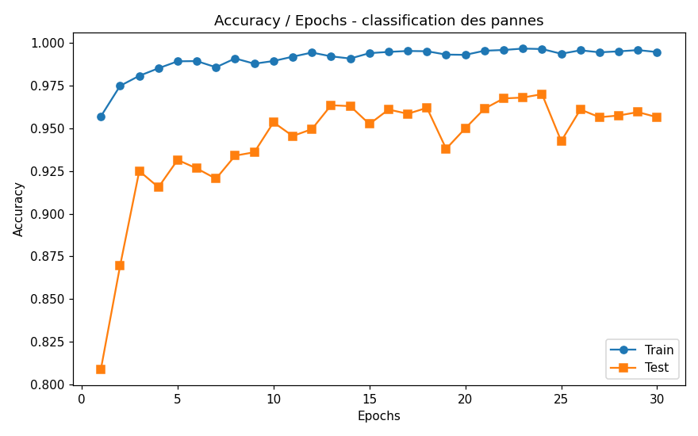

# Deep Learning Atelier - Regression & Classification with PyTorch

Lab work (Master MBD): use PyTorch MLPs for two tasks:

- **Part 1 (regression):** predict the next-day closing price of S&P 500 stocks
  ([NYSE dataset](https://www.kaggle.com/datasets/dgawlik/nyse)).
- **Part 2 (multi-class classification):** predict the failure type of an industrial
  machine from sensor readings
  ([predictive maintenance dataset](https://www.kaggle.com/datasets/shivamb/machine-predictive-maintenance-classification)).

Both parts follow the same steps: EDA, preprocessing, PyTorch model, hyper-parameter
search with `sklearn.GridSearchCV`, training curves, metrics and a regularization study.

## Repository structure

```
part1_regression/
  data.py      # download, EDA, sliding-window features, train/test split
  model.py     # MLP + small sklearn wrapper (needed for GridSearchCV)
  main.py      # grid search, final training, curves, regularization
  data/        # dataset (downloaded automatically if missing)
  results/     # figures, metrics, saved models
part2_classification/
  data.py      # download, cleaning, EDA, SMOTE balancing
  model.py     # MLP classifier + sklearn wrapper
  main.py      # grid search, training, curves, metrics, regularization
  data/        # dataset
  results/     # figures, metrics, reports, saved models
```

## How to run

```bash
pip install -r requirements.txt
python part1_regression/main.py
python part2_classification/main.py
```

The datasets are downloaded automatically from public mirrors if the `data/` folders
are empty. The scripts run on CPU but are much faster with a GPU (tests were done on
Google Colab with a free T4, because my laptop has no GPU). Small variations between
runs are normal (seeds + CPU/GPU), the numbers below come from the runs saved in
`results/`.

---

## Part 1 - Regression (NYSE)

### Data and EDA

851,264 rows, 501 stocks, from 2010-01-04 to 2016-12-30, columns open/close/low/high/volume.
No missing values and no duplicates. The EDA (see `results/p1_01` to `p1_04`) shows that
OHLC prices are almost perfectly correlated (as expected), volume is very skewed (log
scale used) and the dataset covers the different GICS sectors of the S&P 500.

### Features and model

For each stock, the last **5 days of OHLCV** (25 inputs) are used to predict the
**close of the next day**. The split is chronological: 80% train (678,834 samples, until
2015-08-27) and 20% test (169,925 samples). Inputs and target are standardized
(mean/std computed on train only).

The model is an MLP in PyTorch:

```
25 -> Linear(64) -> ReLU -> Linear(32) -> ReLU -> Linear(1)
```

It is wrapped in a small sklearn-compatible class (`TorchMLPRegressor`) so that
`GridSearchCV` can clone it, fit it and call `predict` like any sklearn model.

### Hyper-parameter search (GridSearchCV)

`TimeSeriesSplit(n_splits=2)` is used for the cross-validation, because the samples are
ordered in time (training on the past, validating on the future). The grid tests
3 architectures x 2 learning rates x 2 optimizers x 2 numbers of epochs = 24
configurations, on a regular sub-sample of the train set to save time.

**Best configuration:** `hidden=(64, 32)`, `lr=0.01`, `Adam`, `40 epochs` (CV MSE 0.00084).
Adam and 40 epochs dominate the top of the table (`results/grid_results.csv`).

### Training curves




Both curves go down quickly overall and then stabilize, with no divergence between
train and test (the test curve is noisier). For regression there is no real "accuracy",
so the second curve shows R2 and the percentage of predictions within +-2% of the true
price. R2 is close to 0.9995 which looks suspicious at first, but it is normal here:
tomorrow's close is always very close to today's close, so the task is much easier than
forecasting the market. The residual plot (`results/p1_07_predictions.png`) confirms
that errors are almost always within a couple of dollars.

**Final metrics** (best config retrained on the full train set):

| Metric | Train | Test |
|---|---|---|
| RMSE ($) | 1.55 | 2.27 |
| MAE ($) | 0.75 | 1.05 |
| MAPE | 1.41% | 1.41% |
| R2 | 0.99945 | 0.99951 |
| Accuracy @2% | 77.3% | 77.6% |

### Regularization study

| Variant | Test RMSE | Comment |
|---|---|---|
| Baseline | 2.27 | reference |
| + Dropout 0.2 | 8.44 | much worse, breaks the model |
| + L2 (1e-4) | 3.41 | clearly worse |
| + Dropout + L2 | 10.09 | worst |
| + L1 (1e-5) | 2.48 | a bit worse |
| + Early stopping (p=5) | 2.59 (stops at epoch 10) | cheaper, close score |

Conclusion: the model is not overfitting, so regularizers cannot improve it. Dropout is
even harmful because it destroys the very strong "today's price" signal, and L2/L1
penalties slow down the learning for nothing. Early stopping is the best compromise: it
stops after 10 epochs with a close score (2.59), which is 4x less training time.

---

## Part 2 - Multi-class classification (predictive maintenance)

### Data, cleaning and EDA

10,000 rows of sensor measurements (air/process temperature, rpm, torque, tool wear,
product type) with a binary target and a failure type. The 6 classes are extremely
imbalanced: No Failure 9652, HDF 112, PWF 95, OSF 78, TWF 45, RNF 18.

Preprocessing (`results/preprocessing_report.txt`):
- remove the IDs (UDI, Product ID) and the binary Target column
- one-hot encode the product type (L/M/H)
- add two physical features: `Power = torque x rpm x 2*pi/60` and `Temp diff = process - air`
- standardize the 10 input features (stats from train only)

The rpm x torque scatter (`results/p2_04_scatter_rpm_torque.png`) shows the constant
power curve of the machine, and the failures clearly sit away from it. This figure alone
explains most of the model's performance.

### Balancing with SMOTE

The split (80/20, stratified) is done **before** balancing, so the test set keeps the
real distribution. SMOTE is applied only on the train set: 8,000 -> 46,332 samples
(7,722 per class, k=3 neighbors).

### Model and GridSearchCV

MLP `10 -> Linear(64) -> ReLU -> Linear(32) -> ReLU -> Linear(6)` with CrossEntropy loss,
wrapped in a sklearn class (`TorchMLPClassifier`).

GridSearchCV uses `StratifiedKFold(3)` and scores with **F1-macro** instead of accuracy,
because with only 1.8% failures a model predicting "no failure" would already have 96%
accuracy but be useless. Grid: 3 architectures x 2 lr x 2 optimizers on the balanced
train set.

**Best configuration:** `hidden=(64, 32)`, `lr=0.01`, `Adam` (CV F1-macro 0.9934).

### Curves and metrics




The loss and accuracy curves go down/up quickly and then plateau, the test curve stalls
around 95% accuracy. The full classification report is in
`results/classification_reports.txt`, the confusing pairs are visible in the confusion
matrix (`results/p2_07`).

**Test metrics** (trained on balanced data, evaluated on the real distribution):

| Metric | Value |
|---|---|
| Accuracy | 0.9565 |
| Sensitivity (recall) macro | 0.6255 |
| Precision macro | 0.5069 |
| F1 macro | 0.5515 |
| F1 weighted | 0.9654 |

Per class: HDF and OSF are detected perfectly (recall 1.0), PWF at 0.79, while TWF and
RNF are almost never detected (recall ~0). This is a known limitation of this dataset:
TWF and RNF samples overlap completely with the other classes (only 9 TWF and 4 RNF
samples in the test set), so no model can separate them from the raw sensors.

### Regularization study

| Variant | Acc | F1-macro | Recall-macro |
|---|---|---|---|
| Baseline (SMOTE) | 0.9565 | 0.5515 | 0.6255 |
| Without SMOTE | 0.9805 | 0.5256 | 0.4784 |
| + Dropout 0.3 | 0.9075 | 0.4952 | 0.6599 |
| + L2 (1e-4) | 0.9545 | 0.5531 | 0.6177 |
| + Dropout + L2 | 0.9095 | 0.4799 | 0.6706 |
| + Class weights | 0.9565 | 0.5515 | 0.6255 |
| + Early stopping (p=6) | 0.9315 | 0.5186 | 0.6224 |
| + Label smoothing 0.05 | 0.9445 | 0.5181 | 0.6028 |

Conclusions:
- SMOTE is the most important technique here: without it the accuracy looks better
  (0.98) but that is misleading, because the model then mostly predicts the majority
  class: recall-macro falls to 0.48 and F1-macro to 0.53.
- Dropout increases the recall on rare classes (0.66) but drops the accuracy: a
  compromise, not a free win.
- L2 slightly improves F1-macro (0.5531) without hurting anything else.
- On balanced data, class weights give exactly the same result as the baseline.
- Early stopping and label smoothing both cost a bit of F1.

---

## What I learned

- Writing a PyTorch model is easy, but plugging it into `GridSearchCV` requires a small
  sklearn wrapper (subclass `BaseEstimator` + `fit`/`predict`). It was interesting to
  see that sklearn can drive a PyTorch model exactly like any other estimator.
- The choice of cross-validation matters a lot: `TimeSeriesSplit` for the stock prices
  (time order must be respected) vs `StratifiedKFold` for the machine data.
- Accuracy is a trap with imbalanced data. F1-macro / recall per class showed that the
  model misses two rare failure types completely, which plain accuracy (96%) hides.
- Regularization is not magic: it only helps when the model overfits. In Part 1 the
  signal was so strong that dropout made everything worse. In Part 2 SMOTE did more for
  the rare classes than any classic regularizer.
- Long trainings are much faster on a free Colab GPU than on my laptop, and it is easy
  to write the same script to use CUDA when it is available.
