# Deep Learning Lab - PyTorch

This is my lab work for the Deep Learning course (LSI, FST Tanger -
Universite Abdelmalek Essaadi, Pr. ELAACHAK Lotfi).

I used PyTorch to do two tasks:

- **Part 1 (regression):** predict the next day closing price of stocks
  ([NYSE dataset](https://www.kaggle.com/datasets/dgawlik/nyse)).
- **Part 2 (classification):** predict the failure type of a machine from sensor
  readings
  ([predictive maintenance dataset](https://www.kaggle.com/datasets/shivamb/machine-predictive-maintenance-classification)).

In both parts I followed the same steps: EDA, preprocessing, build an MLP with
PyTorch, search the best hyper-parameters with GridSearchCV (sklearn), draw the
Loss/Epochs and Accuracy/Epochs curves, compute the metrics and test some
regularization techniques.

I did the trainings on Google Colab with a free T4 GPU, because my laptop has no
GPU. The code automatically uses CUDA if it is available, otherwise the CPU.
I also fixed the seed to 42 so the results are repeatable.

## Repository structure

```
part1_regression/
  data.py      # download, EDA, sliding-window features, train/test split
  model.py     # MLP + small sklearn wrapper (needed for GridSearchCV)
  main.py      # grid search, final training, curves, regularization
  data/        # dataset (downloaded automatically if missing)
  results/
    figures/   # p1_01 ... p1_08
    metrics/   # json, csv and text outputs
    models/    # saved .pt weights
part2_classification/
  data.py      # download, cleaning, EDA, SMOTE balancing
  model.py     # MLP classifier + sklearn wrapper
  main.py      # grid search, training, curves, metrics, regularization
  data/        # dataset
  results/
    figures/   # p2_01 ... p2_09
    metrics/   # json, csv and text outputs
    models/    # saved .pt weights
```

## How to run

```bash
pip install -r requirements.txt
python part1_regression/main.py
python part2_classification/main.py
```

The datasets are downloaded automatically from public mirrors if the `data/`
folders are empty. The scripts run on CPU but are much faster with a GPU. The
numbers below come from the runs saved in `results/`, so they can be checked.

---

# Part 1 - Regression (stock prices)

## 1) EDA

The dataset has **851,264 rows and 501 stocks**, from 2010-01-04 to 2016-12-30.
Columns are open, close, low, high, volume. There are no missing values and no
duplicates.

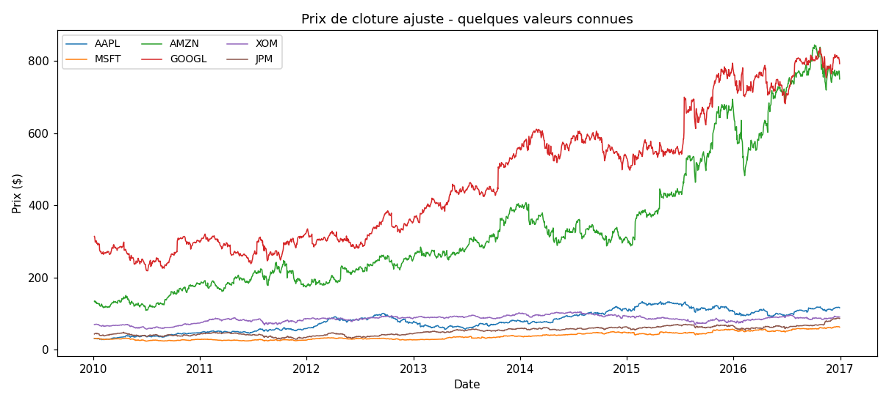

Here I plotted the close price of some known stocks (AAPL, MSFT, AMZN, GOOGL,
XOM, JPM). We can see the different trends over the 7 years. The prices are not
on the same scale (Amazon is much higher), so later I standardize the inputs.

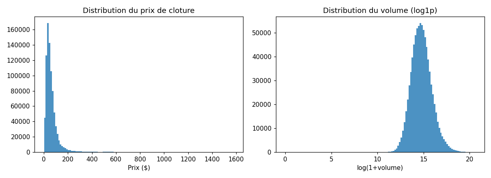

Left: most closing prices are concentrated at low values, with a long
tail. Right: the volume is very skewed, so I plot it with log1p and after that
it looks almost like a normal distribution. This is why the volume will need to
be standardized too.

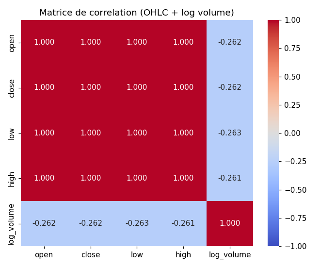

The 4 price columns (open, close, low, high) are almost perfectly correlated
(more than 0.99), which is logical because they move together every day. The
log volume is almost not correlated with the prices. This confirms that the
close of tomorrow is very linked to the close of today.

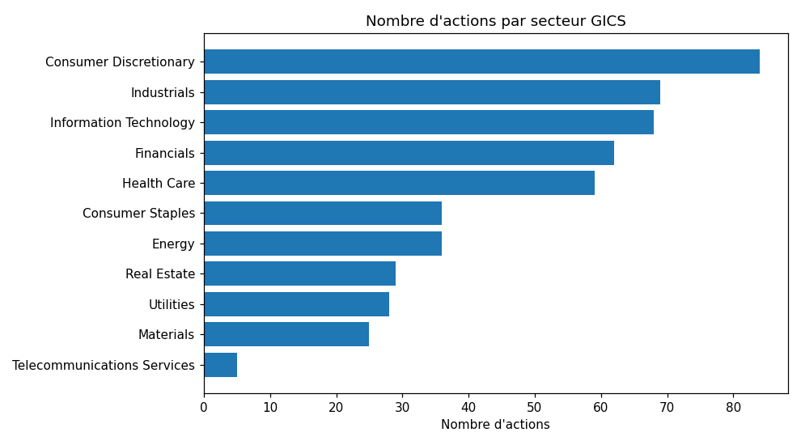

Repartition of the 501 stocks between the GICS sectors. All the sectors of the
S&P 500 are covered, so the dataset is not only one type of company.

## 2) Features and model

For each stock I take the last **5 days** (open, close, low, high, volume) =
25 inputs, and the target is the **close of the next day**.

The split is chronological (no shuffle): 80% train (678,834 samples, until
2015-08-27) and 20% test (169,925 samples). I standardize the inputs and the
target with the mean/std of the **train only**, to avoid leaking test
information.

My model is a small MLP in PyTorch:

```
25 -> Linear(64) -> ReLU -> Linear(32) -> ReLU -> Linear(1)
```

MSE loss, Adam optimizer, batch size 1024.

The problem: GridSearchCV only accepts sklearn models. So I wrote a small class
`TorchMLPRegressor` that wraps the PyTorch model with the sklearn methods
(`fit`, `predict`, `get_params`, `set_params`). After that, sklearn can clone,
train and cross-validate my network like any other estimator.

## 3) GridSearchCV

For the cross-validation I used `TimeSeriesSplit(n_splits=2)`: the data is
ordered in time, so training must always be on the past and validation on the
future (a normal K-fold would "see the future", which is cheating for a stock
problem).

Grid tested: **3 architectures x 2 learning rates x 2 optimizers x 2 epochs =
24 configurations**, on a sub-sample of the train set (135,767 points, every
5th row) to save time. The full table is in `results/metrics/grid_results.csv`.

**Best configuration:** `hidden=(64, 32)`, `lr=0.01`, `Adam`, `40 epochs`
(CV MSE = 0.00084). Adam beats SGD and 40 epochs beat 15 in almost all the top
rows of the table.

## 4) Loss and Accuracy curves


The train and test losses go down very fast during the first epochs and then
they stay almost flat. The test curve is a bit noisy (small jumps at some
epochs) but it never diverges from the train curve, so the model is not really
overfitting the training data.


For a regression there is no real "accuracy", so I plotted the R2 and the
percentage of predictions within +-2% of the true price. R2 is close to 0.9995
for train and test. This looks too good, but the explanation is simple:
tomorrow's closing price is almost always very close to today's closing price,
so the task is much easier than predicting the market. The model learned that,
it does not mean it can predict crashes or real movement.

## Predictions and residuals

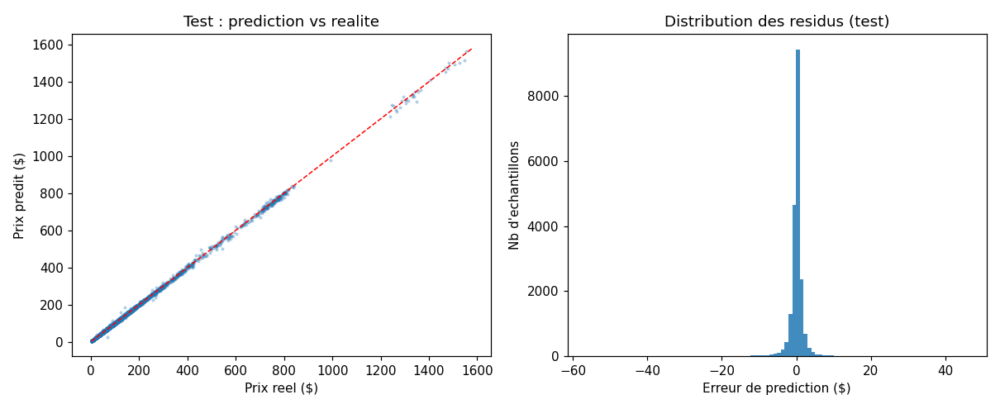

Left: predicted price vs real price (20,000 test samples). The points are all
on the diagonal, which means the predictions are very close to the reality.
Right: the histogram of the errors, centered on 0 and almost all the errors are
within +-2-3 dollars. The mean absolute error is 1.05$ on the test set.

**Final metrics** (best config retrained on the full train set):

| Metric | Train | Test |
|---|---|---|
| RMSE ($) | 1.55 | 2.27 |
| MAE ($) | 0.75 | 1.05 |
| MAPE | 1.41% | 1.41% |
| R2 | 0.99945 | 0.99951 |
| Accuracy @2% | 77.3% | 77.6% |

Train and test are very close, so the model generalizes well.

## 5) Regularization study

I retrained the same best configuration with different techniques and compared
the test results:

| Variant | Test RMSE | Comment |
|---|---|---|
| Baseline | 2.27 | reference |
| + Dropout 0.2 | 8.44 | much worse, breaks the model |
| + L2 (weight decay 1e-4) | 3.41 | clearly worse |
| + Dropout 0.2 + L2 | 10.09 | worst of all |
| + L1 (penalty 1e-5) | 2.48 | a bit worse |
| + Early stopping (p=5) | 2.59 (stops at epoch 10) | close score, 4x less epochs |

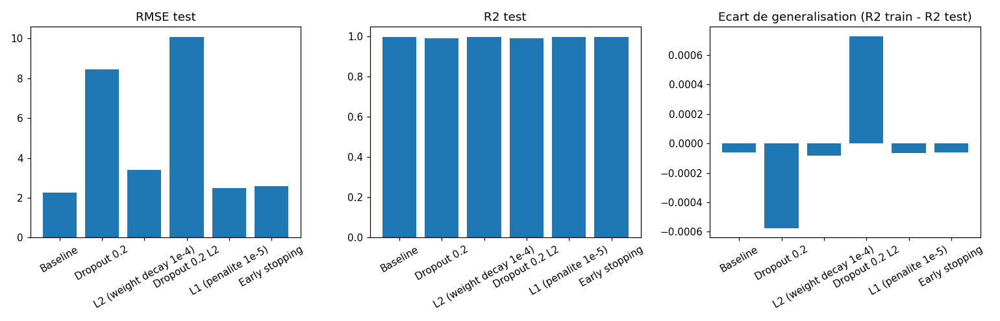

Interpretation: the baseline model does not overfit (train and test are very
close), so the regularizers cannot improve it. Dropout is even very harmful
(RMSE 8.44 / 10.09) because it destroys the most useful input of the model: the
"today price" information. L2/L1 penalties slow down the learning for nothing.
The only interesting technique is **early stopping**: after 10 epochs the score
is almost the same (2.59) and the training is 4 times shorter.

---

# Part 2 - Classification (machine failures)

## 1) Preprocessing and cleaning

10,000 rows of sensor measurements: air temperature, process temperature,
rotational speed, torque, tool wear, product type (L/M/H), a binary Target and
a failure type with 6 classes: No Failure, HDF, PWF, OSF, TWF, RNF.

What I did:
- removed `UDI`, `Product ID` (just identifiers) and `Target` (it is the binary
  version of the failure type, so keeping it would leak the answer);
- one-hot encoded the product type (3 columns);
- added 2 physical features: `Power = torque x rpm x 2*pi/60` (the machine
  works at almost constant power) and `Temp diff = process - air`;
- standardized the 10 input features with the train statistics.

## 2) EDA

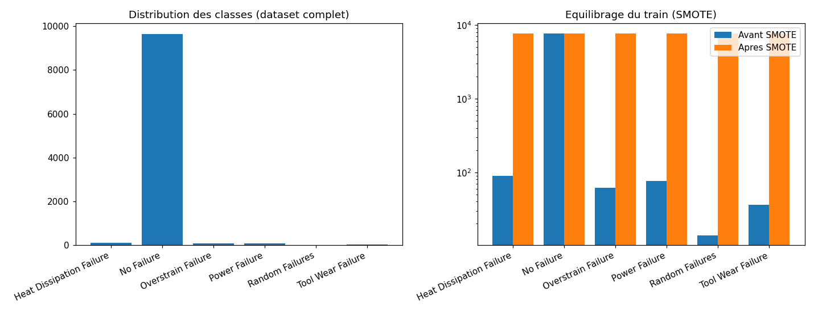

The dataset is extremely imbalanced: No Failure 9652 samples, but Random
Failures only 18. If I train like this, the model will just predict "No
Failure" all the time. Right plot: after SMOTE (applied on train only) all the
6 classes have the same number of samples (7,722 each).

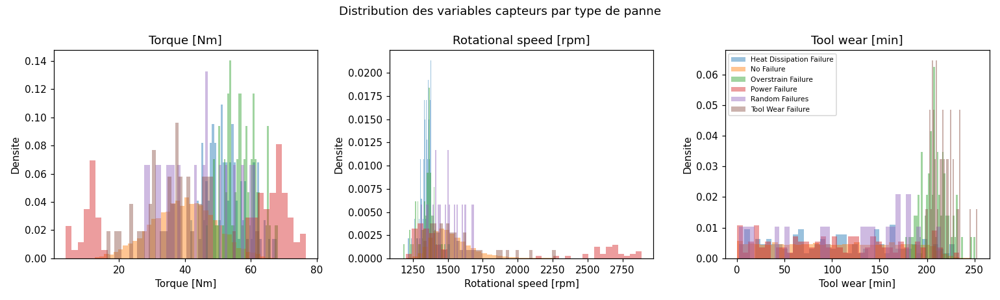

Sensor distributions for each class (torque, rpm, tool wear). We can see that
some failures (like OSF, the overstrain failure) are clearly in the extremes
(very high torque), but the rare classes (TWF, RNF) overlap completely with No
Failure. That is a warning: these two classes will be very hard to detect.

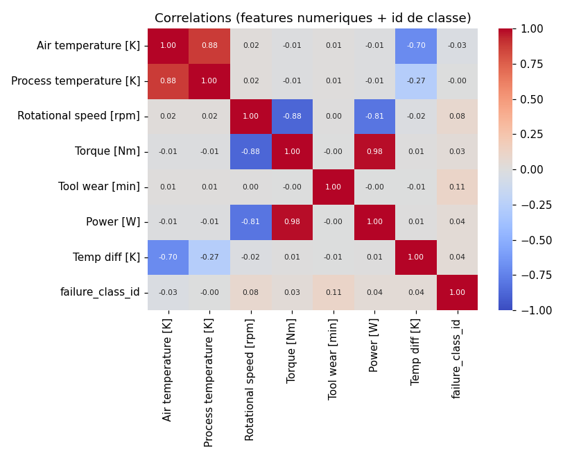

Correlation matrix. My `Power` feature is very correlated with torque and rpm
(logical), and `Temp diff` with the two temperatures. The failure class has
only weak correlations with everything, so no single sensor is enough to
predict the class.

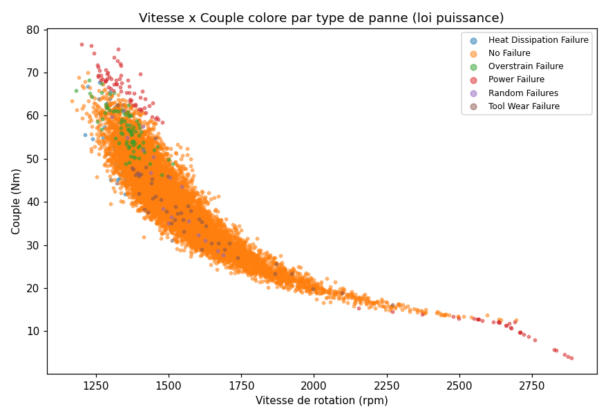

This is my favorite figure: rpm vs torque colored by failure type. The normal
points follow a hyperbola (constant power of the machine), and the failures
mostly sit away from this curve (low speed + high torque, or very high speed).
This explains why the model can detect some failures so easily.

## 3) Balancing with SMOTE

The train/test split (80/20, stratified) is done **before** any balancing, so
the test set keeps the true distribution (2000 samples, with only 9 TWF and 4
RNF).

SMOTE is applied only on the train set: 8,000 -> **46,332 samples** (7,722 per
class, k=3 neighbors). Later in the regularization study I compare this with a
model trained without SMOTE to show its effect.

## 4) Model

MLP in PyTorch:

```
10 -> Linear(64) -> ReLU -> Linear(32) -> ReLU -> Linear(6)
```

CrossEntropyLoss, batch size 512, 30 epochs. Same as part 1, a small sklearn
wrapper (`TorchMLPClassifier`) is needed to use GridSearchCV.

## 5) GridSearchCV

`StratifiedKFold(3)` with **F1-macro** as the score, not accuracy, because a
model that always predicts "No Failure" already has 96.5% accuracy but it is
useless (it finds zero failures). Grid: 3 architectures x 2 lr x 2 optimizers =
12 configurations, trained on the balanced train set.

**Best configuration:** `hidden=(64, 32)`, `lr=0.01`, `Adam` (CV F1-macro =
0.9934).

## 6) Curves


The loss decreases quickly during the first epochs and then becomes stable. The
test loss is a bit above the train loss, which is normal because the test set
keeps the real (imbalanced) distribution.


The test accuracy jumps to ~95% after a few epochs and then stops improving.
The train accuracy goes up to ~99%, so there is a small gap, but it does not
get worse with more epochs. Conclusion: training longer would not help, the
useful learning happens in the first 10 epochs.

## 7) Metrics

**Test metrics** (trained on the balanced data, evaluated on the real
distribution, 2000 samples):

| Metric | Value |
|---|---|
| Accuracy | 0.9565 |
| Sensitivity (recall) macro | 0.6255 |
| Precision macro | 0.5069 |
| F1 macro | 0.5515 |
| F1 weighted | 0.9654 |

The accuracy (95.65%) looks good, but it hides the real problem: the F1-macro
is only 0.55. On the balanced train set the F1-macro is 0.9946, so the huge gap
comes from the fact that the test set has the real distribution, with very few
examples of rare failures.

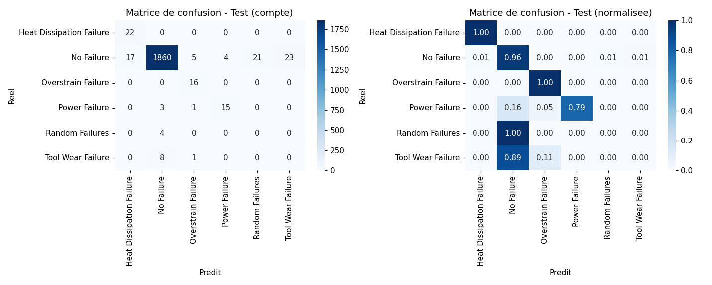

Confusion matrix (counts + normalized). HDF and OSF are detected perfectly
(recall 1.0), PWF at 0.79. But TWF and RNF are never detected (0/9 and 0/4):
they look exactly like normal samples in the sensors, so the model cannot
separate them. This is a known limitation of this dataset.

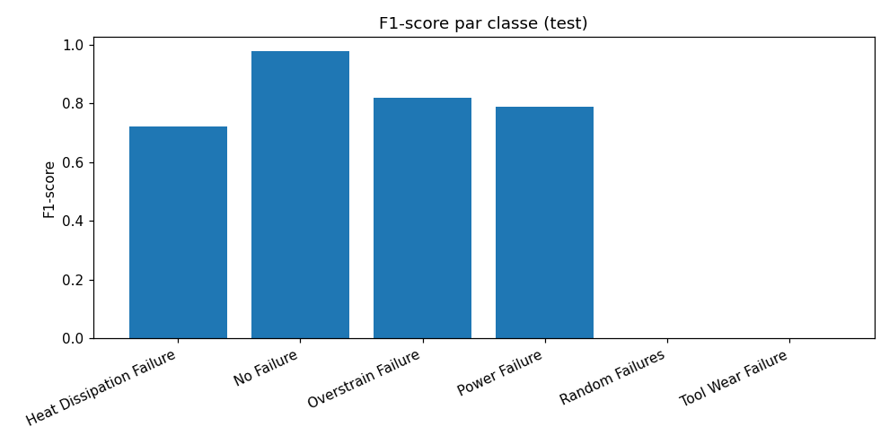

F1-score per class: No Failure ~0.98, OSF ~0.82, PWF ~0.79, HDF ~0.72, and
TWF/RNF = 0. The two rare classes are what pull the macro average down.

## 8) Regularization study

| Variant | Acc | F1-macro | Recall-macro |
|---|---|---|---|
| Baseline (SMOTE) | 0.9565 | 0.5515 | 0.6255 |
| Without SMOTE | 0.9805 | 0.5256 | 0.4784 |
| + Dropout 0.3 | 0.9075 | 0.4952 | 0.6599 |
| + L2 (1e-4) | 0.9545 | 0.5531 | 0.6177 |
| + Dropout + L2 | 0.9095 | 0.4799 | 0.6706 |
| + Class weights | 0.9565 | 0.5515 | 0.6255 |
| + Early stopping (p=6) | 0.9315 | 0.5186 | 0.6224 |
| + Label smoothing 0.05 | 0.9445 | 0.5181 | 0.6028 |

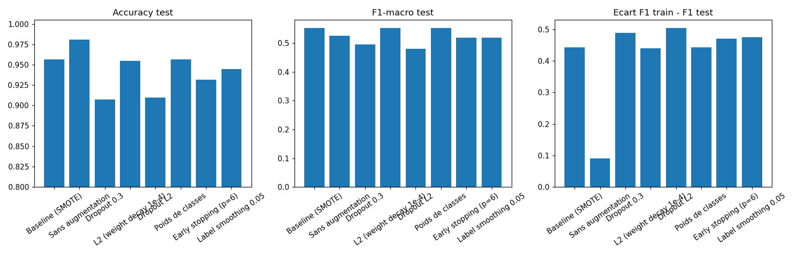

From this table, I can see that:
- **SMOTE is the most important technique here.** Without it the accuracy is
  higher (0.98) but fake: the model mostly predicts "No Failure", the
  recall-macro drops to 0.48 and the F1-macro to 0.53.
- **Dropout** increases the recall of the rare classes (0.66) but decreases the
  accuracy: a compromise, not a free win.
- **L2** improves the F1-macro very slightly (0.5531) and does not hurt.
- **Class weights** give exactly the same result as the baseline, because the
  data is already balanced by SMOTE, so the weights add nothing.
- **Early stopping** and **label smoothing** lose a bit of F1.

---

# What I learned

- How to build, train and evaluate an MLP with PyTorch (nn.Module, DataLoader,
  loss, optimizer, training loop, GPU/CPU).
- How to connect PyTorch with scikit-learn: GridSearchCV needs an sklearn-style
  class, so I wrote a wrapper with `get_params`/`set_params`/`fit`/`predict`.
  It was interesting to see sklearn driving a PyTorch model like any other
  estimator.
- The cross-validation must respect the data: TimeSeriesSplit for the stocks
  (time order) and StratifiedKFold for the machines (class balance in each
  fold).
- Accuracy is misleading with imbalanced data. The F1-macro and the per-class
  recall showed that my model completely misses 2 of the 5 failure types, which
  plain accuracy (96%) hides.
- Regularization is not magic: it helps only when the model overfits. In part 1
  dropout made everything worse, and in part 2 SMOTE helped the rare classes a
  lot more than any classic regularizer.
- Long trainings are much faster on the free Colab GPU than on my laptop.
